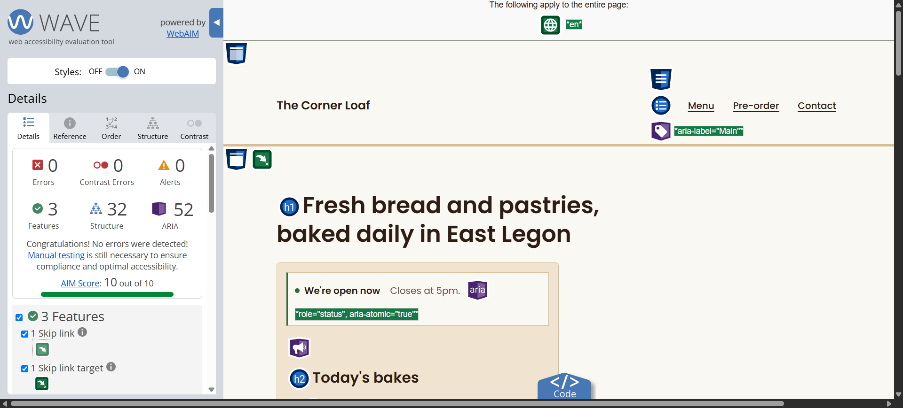
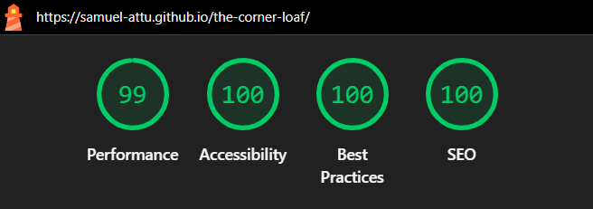
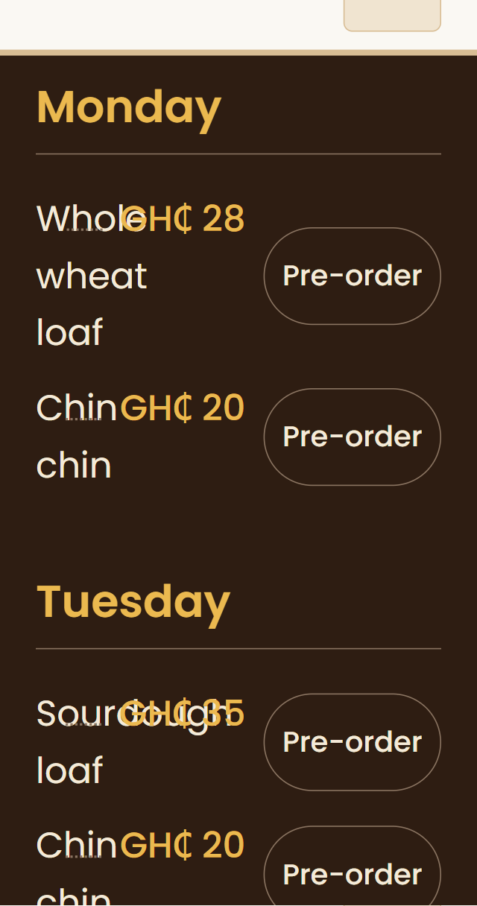
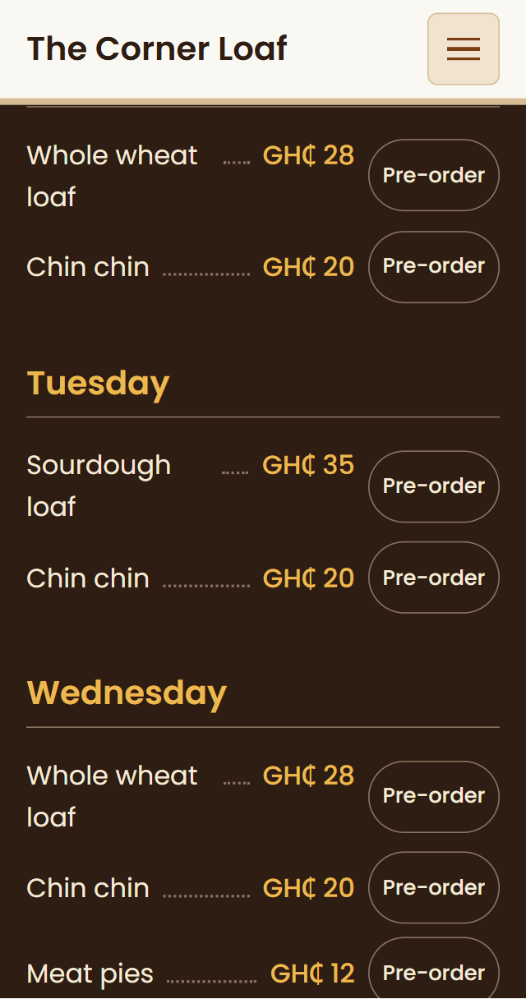
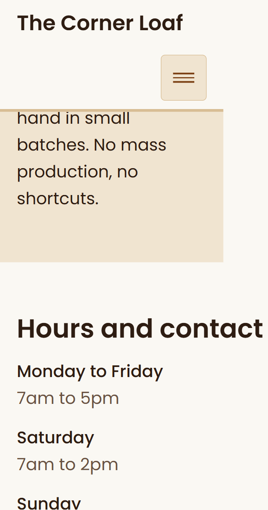
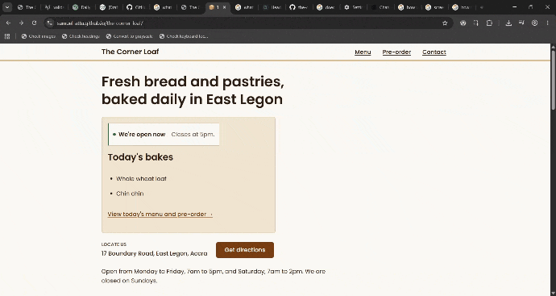
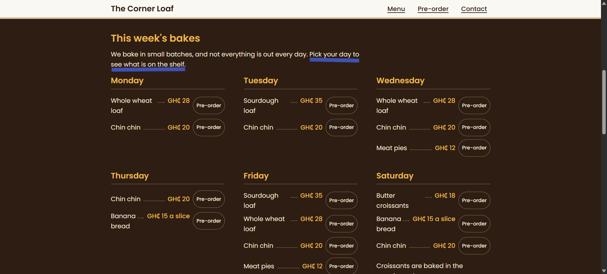

# Accessibility audit: The Corner Loaf site by Samuel

- Site audited: https://samuel-attu.github.io/the-corner-loaf/
- Date and time tested: 16 November 2026, 9AM
- Audited by: Joshua
- Standard: WCAG 2.2, level AA

## How I tested

- Automated tools: WAVE (10/10) and Lighthouse (accessibility score 100 on every run).
   
- Keyboard: I tabbed through every link and button on the page, used the header navigation links, the Mon to Sun day links, the "View today's menu and pre-order" link, and opened and closed the mobile menu with Enter and Space.
- Zoom, text size and reflow: browser responsive view at 320px wide, first at default text size and then with the browser font size set to "very large". Also tested on desktop default width at 200% zoom and 400% zoom.
- Screen reader: NVDA on Windows, Chrome.
- Pages and journeys covered: the site is a single page. I covered reading the whole page with NVDA, finding a day's bakes and prices, using the header navigation and day links, opening the mobile menu, and reading the hours and contact details.

## Summary

Samuel's Corner Loaf site works well for people who use a screen reader: it passed automated checks, NVDA could read the whole page in a sensible order, and every link and button can be reached by keyboard. The biggest problems affect people who enlarge their text, especially on a phone. At very large text sizes the item names run into their prices, the day links land with the heading hidden under the header, and the contact section forces sideways scrolling. Smaller issues, such as the mobile menu not closing with the Escape key, are worth fixing after those. Colour contrast, page structure and link labelling are already strong.

## Findings, in priority order

### 1. Prices run into item names when someone enlarges text on a phone

- Where: Menu section ("This week's bakes"), the item rows in each day's list.
- What happens: with the text set very large on a narrow screen, the price overlaps the item name on rows with longer names. For example, in "Sourdough loaf" the name wraps onto a second line and the price sits on top of "Sourdough". A short name such as "Chin chin" wraps cleanly and the price stays clear. The text is still partly legible, but it is hard to read, and harder for someone with low vision.
- How to reproduce:
  1. Open the site in Chrome and set the browser font size to "Very large" in settings.
  2. Switch to responsive view and set the width to 320px.
  3. Scroll to "This week's bakes" and look at the item rows, for example Saturday.
  4. The item names overlap the prices.
- Evidence: observed at 320px with very large text; at 320px with default text there is no overlap.

  

- Principle and criterion: Perceivable; 1.4.4 Resize Text (AA) and 1.4.10 Reflow (AA).
- Who it affects and how: people with low vision who enlarge text so they can read at all. They cannot read the prices, which is the main reason to visit the page.
- Found by: zoom and text-size testing.
- Why it ranks here: the menu and its prices are the purpose of the page, and this failure makes them unreadable. Severity is significant, not Critical, because the text is still partly legible and short names wrap cleanly, so nobody is completely blocked.

### 2. Jumping to a day's menu lands with the heading hidden behind the header

- Where: the Mon to Sun day links (shown at mobile width), the "View today's menu and pre-order" link in the intro, and the day headings they point to.
- What happens: after activating one of these links the page scrolls so the day's heading sits underneath the sticky header. The person lands in the middle of a list without seeing which day it belongs to. The header's own navigation links land correctly.
- How to reproduce:
  1. Open the site at a narrow width so the day links appear.
  2. Activate "Wed" in the day links.
  3. Check whether the "Wednesday" heading is visible. It is covered by the header.
  4. Repeat with the "View today's menu and pre-order" link in the intro.
  5. Compare with the "Menu" link in the header, which lands correctly.
- Evidence: observed on both links. The image below shows a screenshot with the monday heading hidden behind the page header./nav bar.

  

- Principle and criterion: Operable; 2.4.11 Focus Not Obscured (Minimum) (AA, WCAG 2.2). The criterion covers focused content, and the same sticky-header overlap hides the jump target here.
- Who it affects and how: keyboard users, screen magnifier users and people who zoom. They rely on landing where the link promised, and lose track of which day they are reading.
- Found by: keyboard and link activation.
- Why it ranks here: it affects every in-page link in the menu, which is the main navigation of the site. It is not a blocker, because scrolling up a little recovers the heading. Severity is moderate.

### 3. The contact section forces sideways scrolling when text is enlarged

- Where: "Hours and contact" heading, and the email address under "Get in touch".
- What happens: the heading and the email address do not wrap, so the whole page scrolls sideways. A person must pan left and right to read the contact details.
- How to reproduce:
  1. Set the browser font size to "Very large".
  2. Set the responsive view to 320px wide.
  3. Scroll to "Hours and contact".
  4. The page scrolls horizontally, and the heading and email do not wrap.
- Evidence: observed at 320px with very large text.

  

- Principle and criterion: Perceivable; 1.4.10 Reflow (AA).
- Who it affects and how: people with low vision who zoom or enlarge text, and who should not need to scroll in two directions.
- Found by: zoom and text-size testing.
- Why it ranks here: it is a clear failure of a level AA criterion, but it affects the contact details and not the menu. Severity is moderate.

### 4. The header breaks apart and half of it disappears when text is very large

- Where: the site header, with the "The Corner Loaf" name and the menu button.
- What happens: the name does not wrap, which pushes the menu button down. While scrolling on a phone only about half of the header is visible.
- How to reproduce:
  1. Set the browser font size to "Very large".
  2. Set the responsive view to 320px wide.
  3. Look at the top of the page, then scroll down.
  4. The menu button sits below the name, and the header is only partly visible while scrolling.
- Evidence: observed at 320px with very large text. It causes no horizontal scrolling. I did not trace the half-hidden header to one cause.

  

- Principle and criterion: Perceivable; 1.4.10 Reflow (AA), as a related layout failure.
- Who it affects and how: people with low vision on phones, for whom the header is awkward and takes up screen space.
- Found by: zoom and text-size testing.
- Why it ranks here: it is untidy but content stays reachable. Severity is recommendation.

### 5. The mobile menu cannot be closed with the Escape key

- Where: the menu button and the open navigation at mobile width.
- What happens: pressing Escape does nothing. The only way to close the menu is to go back to the menu button and press Enter or Space.
- How to reproduce:
  1. Set the window to a mobile width.
  2. Tab to the menu button and press Enter to open the menu.
  3. Press Escape.
  4. The menu stays open.
- Evidence: observed. No screen reader involved.
- Principle and criterion: Operable; no WCAG criterion fails, because the button works by keyboard (2.1.1 Keyboard, A, is met). This is best practice from the ARIA disclosure pattern.
- Who it affects and how: keyboard users, including people with motor impairments who find extra key presses costly.
- Found by: keyboard.
- Why it ranks here: there is a working route to close the menu, just a longer one. Severity is recommendation.

### 6. Reloading the page throws a person back to the top

- Where: the whole page.
- What happens: after reloading, the page returns to the top and the section name is removed from the address.
- How to reproduce:
  1. Use the header navigation to go to "Menu" (the address gains #menu).
  2. Reload the page.
  3. The page is at the top and the address has lost #menu.
- Evidence: 
- Principle and criterion: Understandable; no WCAG criterion fails. This is best practice about unexpected behaviour.
- Who it affects and how: magnifier users and people who find it hard to find their place again.
- Found by: manual check.
- Why it ranks here: it appears to be deliberate and the cost is small. Severity is recommendation.

### 7. The page asks people to pick a day on desktop, where there is nothing to pick

- Where: the intro paragraph under "This week's bakes".
- What happens: the text reads "Pick your day to see what is on the shelf." The day links only exist at mobile widths. On desktop every day is already visible.
- How to reproduce:
  1. Open the site at desktop width.
  2. Read the paragraph under "This week's bakes".
  3. Look for the day links. There are none.
- Evidence: 
- Principle and criterion: Understandable; no WCAG criterion fails. This is best practice about instructions that match the controls.
- Who it affects and how: desktop and screen reader users, who may look for a control that is not there.
- Found by: manual check.
- Why it ranks here: all the content is visible, so nothing is blocked. Severity is recommendation.

### 8. Prices are read out as letters: "G H Ghanaian cedi"

- Where: the price in each menu row.
- What happens: NVDA reads the price as the letters "G H", then "Ghanaian cedi", then the number. It is understandable but clumsy.
- How to reproduce:
  1. Turn on NVDA.
  2. Move through a menu row to its price.
  3. Listen to the announcement.
- Evidence: NVDA announces "G H Ghanaian cedi" followed by the number.
- Principle and criterion: Perceivable; no WCAG criterion fails. This is best practice for how content is announced.
- Who it affects and how: screen reader users, who hear the currency spelled out letter by letter.
- Found by: screen reader.
- Why it ranks here: nothing is lost and the announcement is accurate. Severity is recommendation.

## What works well

- Automated checks: WAVE scored 10/10 and Lighthouse accessibility scored 100 on every run.
- Keyboard: every link and button is focusable and the order is predictable, checked by tabbing through the whole page.
- Screen reader: I could navigate the entire page with NVDA by listening alone, which is the situation in Marcus's brief.
- Contrast: the lowest ratio I measured with a contrast checker was 6.82:1, above the 4.5:1 minimum.
- Reflow at default text size: no problems at 320px wide, tested in responsive view.
- Page structure: the page source has `lang="en"`, a skip link, one `h1`, no skipped heading levels, and header, navigation, main and footer landmarks. Each pre-order link has an accessible name that includes the item and the day.

## Not tested, and limits of this audit

- Assistive technology: VoiceOver (iPhone and Mac Safari) and TalkBack (Android) were not tested. Safari can drop list meaning from lists styled with `list-style: none`, which this site uses. I could not confirm whether it affects the menu, so I record it as an untested risk and not a finding.
- Browsers and devices: only Chrome on one Windows laptop. Firefox, Safari, Edge and real phones were not covered.
- Time-based behaviour: the "today" panel changes with the opening hours. I did not test it at opening or closing time, so it is based on reading the code only.
- Other settings: forced colours and high contrast mode, were not tested.
